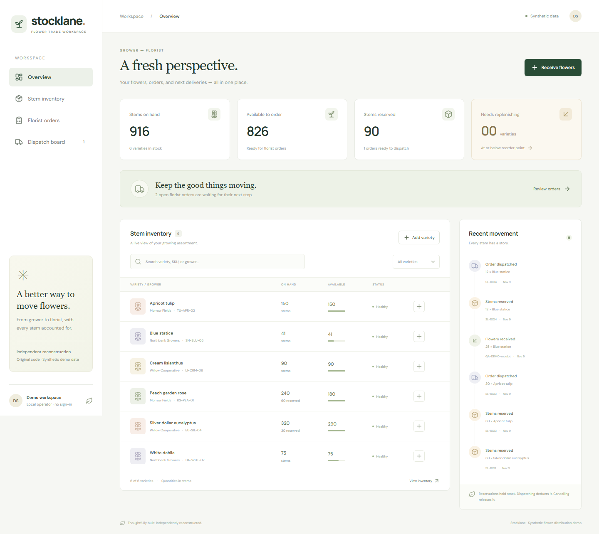

# Stocklane — flower distribution reconstruction

A working, independently built flower distribution workspace: receive stems from growers, create florist orders, reserve stock, and dispatch without overselling. NestJS + React + TypeScript, backed by a local SQLite database. All growers, florists, products, and transactions in the demo are synthetic.



[View the mobile workspace](docs/screenshots/workspace-mobile.png)

> **Provenance and dates:** The supplied resume reports work on a CAVIN flower distribution platform during **April–August 2026**. That is a resume-reported work period, not this repository's development history or independently verified employment. **This reconstruction was created in November 2026.** It contains newly written demonstration code, not employer source, confidential materials, an official CAVIN implementation, or proof of any person's past contribution. Git commits use their actual creation dates. See [source context](docs/source-context.md).

## Run locally

Requires **Node.js 24.4 or later on the 24.x line** and npm. Node's built-in `node:sqlite` avoids an external database or native database package installation.

```sh
npm ci
npm run dev
```

Open **http://127.0.0.1:5173**. The API listens at **http://127.0.0.1:3100**. On Windows, use `npm.cmd` if PowerShell blocks the `npm.ps1` launcher. For a workspace-local npm cache, append `--cache .npm-cache` to installation commands.

For a production build served entirely by Nest:

```sh
npm run build
npm start
```

Open **http://127.0.0.1:3100**. No cloud account, credentials, or paid API is required. Web fonts are optional; the UI falls back to installed fonts if Google Fonts is unavailable.

Copy `.env.example` to `.env` to change the server port, database location, or development web origin. The Vite development proxy targets port 3100; update `vite.config.mts` if you change that port. Defaults work without an `.env` file. The database is created at `data/stocklane.db`; generated data and environment files are ignored by Git. The first run seeds six flower varieties and three sample orders, only when the item table is empty.

## Try the workflow

1. Open **Stem inventory** and search by flower, SKU, or grower. Add a new variety with an opening stem count and a reorder point.
2. Select **Receive flowers**, choose a variety, and record a positive stem quantity with a purchase/delivery reference.
3. Open **Florist orders** and create a draft with one or more flower varieties. Drafts do not hold inventory.
4. Select **Reserve stems**. All lines are reserved atomically; a shortage leaves the entire order and inventory unchanged.
5. Open **Dispatch board** and select **Dispatch order**. This confirms fulfillment and deducts both the physical stock and its reservation.
6. Alternatively, cancel a draft or reserved order. Cancelling a reserved order releases its stems without reducing physical stock.

The preloaded **Juniper Floral Studio** order is already reserved and can be dispatched immediately. **Sunday Stem Shop** is a draft. **Blue statice** begins below its reorder point, so the replenishment filter has a useful example.

## What is implemented

- Dashboard with on-hand, available, reserved, low-stock, and open-order metrics.
- Grower-tagged stem inventory, literal text search, category/low-stock filters, and variety creation.
- Procurement receipts with quantity validation and a movement trail.
- Multi-line florist orders and explicit `draft → reserved → shipped` transitions.
- Cancellation and reservation release, including protection against double fulfillment.
- A dispatch board containing reserved orders only.
- File-backed SQLite persistence, foreign keys, check constraints, write transactions, and parameterized queries.
- Responsive UI, keyboard-accessible native dialogs, pending/error feedback, and empty states.

## Architecture and stock rules

```text
React / Vite
    │ JSON /api/* (same origin in production)
    ▼
NestJS controller + domain error filter
    ▼
InventoryStore — validation + BEGIN IMMEDIATE transactions
    ▼
SQLite: items / orders / order_lines / movements
```

`available = on_hand - reserved`. Database constraints enforce `0 ≤ reserved ≤ on_hand`. Reserving checks availability and updates every line inside a single write transaction. A failed line rolls back previous line updates and movement entries. Dispatch requires the reserved state and consumes held stock once. Terminal states reject repeated transitions with HTTP 409. Cancelling a draft does not touch another order's reservations.

Quantities are whole stems. Unit costs are whole **JPY**, with no floating-point currency arithmetic. The movement trail records receipts, holds, releases, and dispatches. It is an operational history, not an accounting ledger. The `shipped` state represents dispatch confirmation; there is no delivery carrier integration or claim of final delivery.

Important files:

| File | Responsibility |
| --- | --- |
| `api/store.ts` | Schema, validation, transactions, transitions, synthetic seed |
| `api/app.ts` | Nest REST routes, status mapping, CORS, static frontend |
| `api/main.ts` | Environment configuration, startup, graceful shutdown |
| `web/main.tsx` | Inventory, order, receipt, and dispatch UI |
| `test/inventory.test.ts` | Stock invariants, rollback, validation, persistence |
| `test/api.test.ts` | Real HTTP contract and end-to-end state flow |

## API

| Method | Path | Purpose |
| --- | --- | --- |
| GET | `/api/health` | Service health |
| GET | `/api/dashboard` | Inventory, orders, recent movements, metrics |
| GET | `/api/items?search=rose` | Search varieties |
| POST | `/api/items` | Add a variety |
| POST | `/api/items/:id/receipts` | Receive grower stock |
| GET | `/api/orders` | Orders and their lines |
| POST | `/api/orders` | Create a draft |
| POST | `/api/orders/:id/reserve` | Atomically hold all order lines |
| POST | `/api/orders/:id/ship` | Confirm dispatch and consume stock |
| POST | `/api/orders/:id/cancel` | Cancel and release any reservation |

Create-order body:

```json
{
  "customer": "Demo Floral Studio",
  "lines": [{ "itemId": 1, "quantity": 20 }]
}
```

Receipt body:

```json
{ "quantity": 50, "note": "PO-DEMO-104 — grower delivery" }
```

Validation errors return 400, missing records 404, duplicate SKUs/invalid transitions/insufficient availability 409. Error bodies contain `message` and `statusCode`.

## Verification

```sh
npm test
npm run build
npm run smoke
# or both:
npm run check
```

The suite exercises a real in-memory SQLite database and a Nest HTTP server on an ephemeral local port. It covers reservation and dispatch arithmetic, competing reservations, atomic multi-line rollback, duplicate dispatch rejection, cancellation release, receipt validation, duplicate order-line/SKU rejection, literal SQL-safe search, persistence across reopening, and API response codes. A temporary file-backed database is cleaned up after the persistence test. The production smoke check verifies that the built frontend HTML and JavaScript are served by Nest and that the seeded dashboard API responds. It does not perform a visual browser test.

Additional isolated headless-Chrome verification exercised receiving stock, creating an unreserved draft, reserving, dispatching, and persisting the shipped order after reload, with no JavaScript page errors. Responsive checks covered a fresh 390px viewport, desktop-to-mobile resizing, navigation open/backdrop dismissal, and receipt-dialog sizing/Escape dismissal. The included screenshots show synthetic data after that demonstration flow. These browser checks were performed during creation; they are not an installed browser-test suite in this repository.

## Scope and limitations

This is a runnable local demonstration, **not a production multi-tenant service**. It deliberately has no authentication or authorization, user accounts, payments, transport providers, perishable lot/expiry tracking, returns, carrier tracking, or external integrations. Run it on localhost using synthetic data. The server binds to `127.0.0.1` by default. Add access controls, expiry/quality management, request idempotency keys, backups, migrations, observability, and deployment hardening before adapting it for real operations.

Repeated state transitions cannot double-fulfill an order. Receipt submissions and order creation do not yet have retry idempotency keys. The UI disables pending submissions; API clients must avoid replaying those create operations. SQLite's synchronous interface suits this small demo; large workloads need a separately evaluated persistence/concurrency design. The current schema bootstraps with `CREATE TABLE IF NOT EXISTS`; it is not a migration framework.

## License

MIT. No employer affiliation or endorsement is implied.
